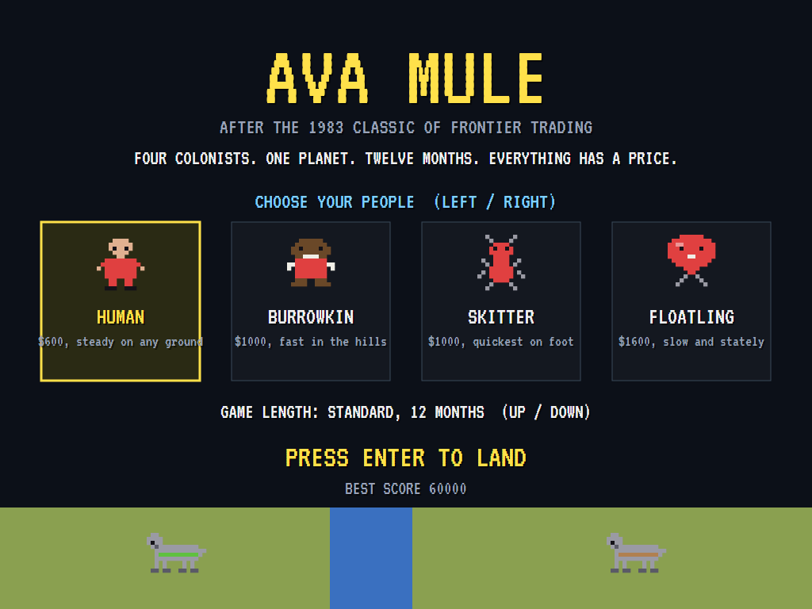
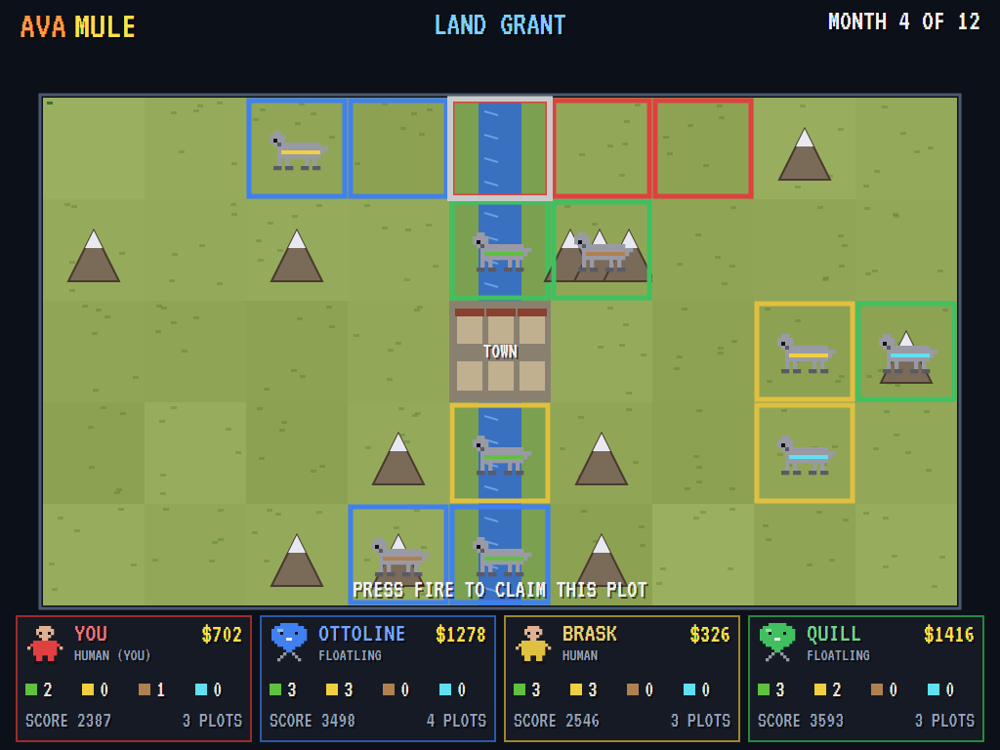
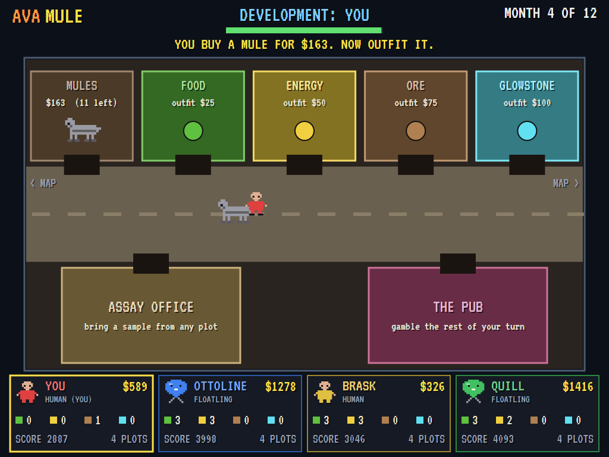
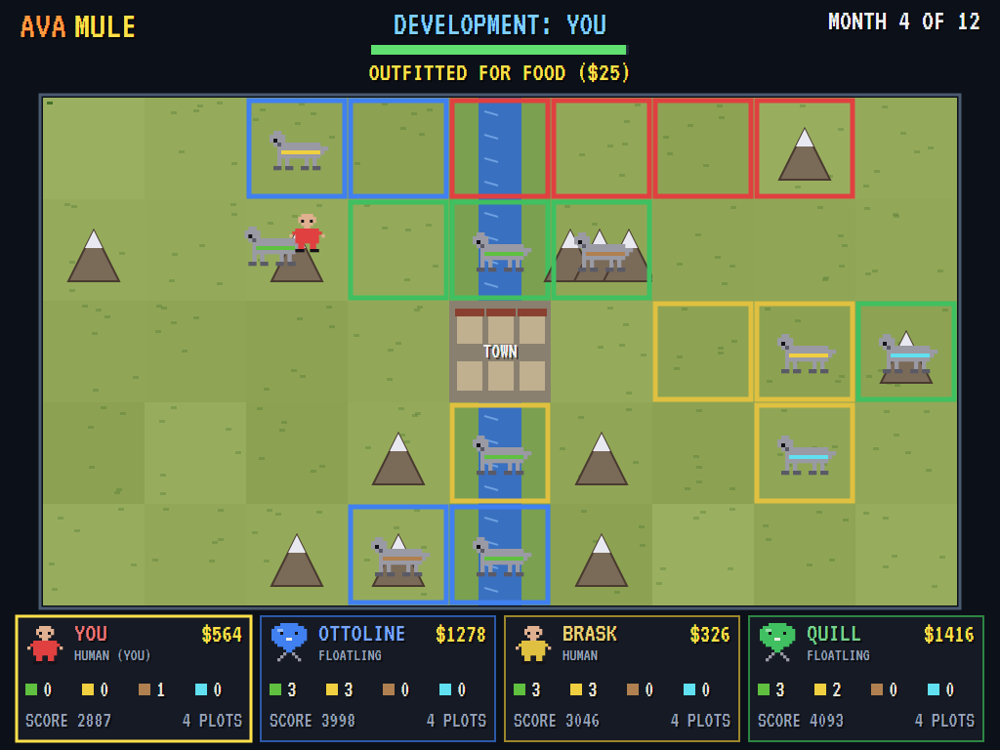
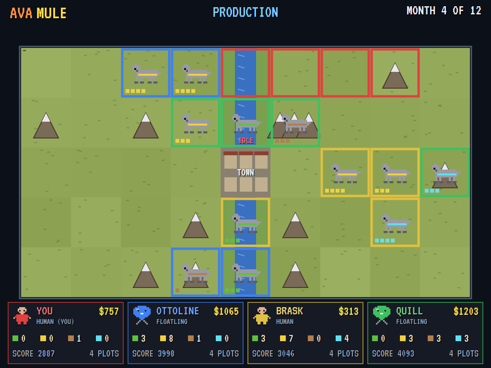
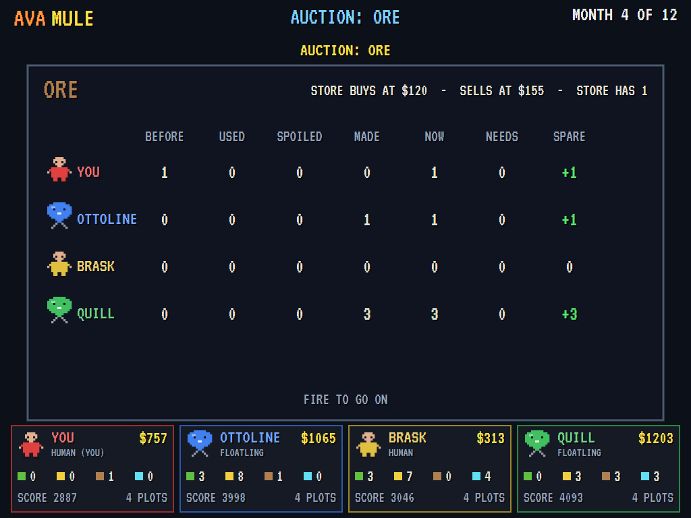
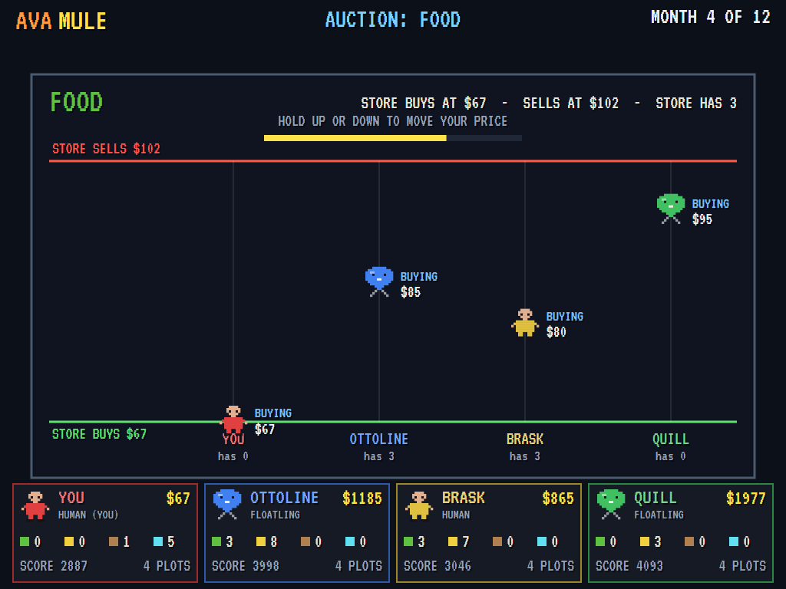
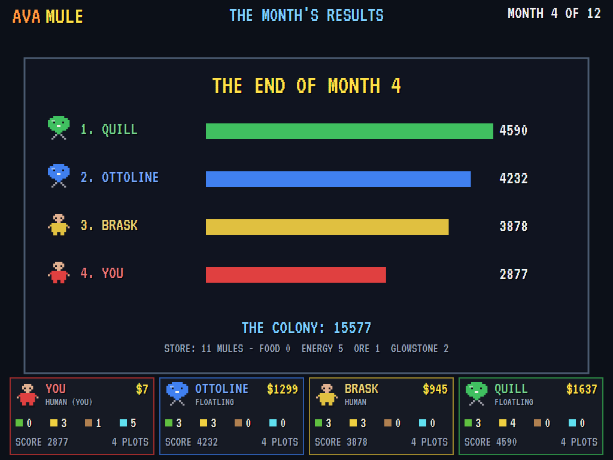
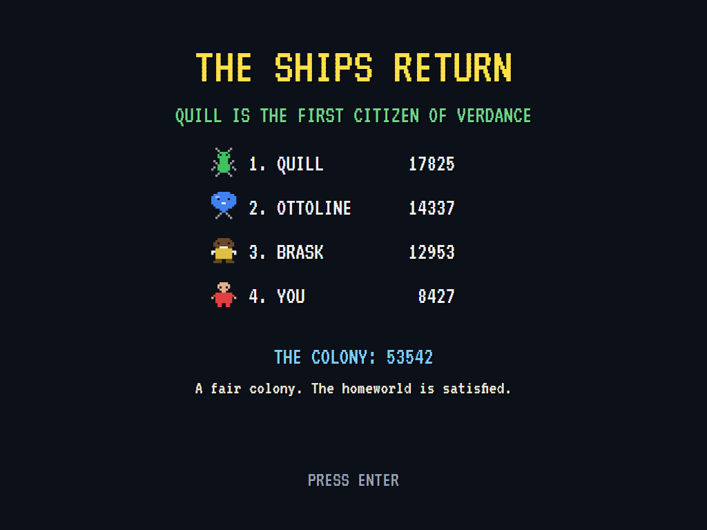

# AVAMule

[](https://github.com/Harlock123/AVAMule/actions/workflows/build.yml)

A frontier trading game in the spirit of Ozark Softscape's 1983 classic **M.U.L.E.**, built with .NET
10 and Avalonia UI. You are one of four colonists on the new world of **Verdance**. Each month you
claim land, buy robot mules, outfit them to farm, make energy, mine ore or dig glowstone, and lead them
out to your plots. Then you haggle with the other colonists in live auctions to sell what you have
spare and buy what you're short of. The richest colonist wins, but the colony only thrives if
everyone gets fed.

The planet, peoples, goods and wording are original: this is the *style* of the classic, not its
contents.

## A month on Verdance

1. **Land grant**: a cursor sweeps the map. Press fire when it's on the plot you want.
2. **Development**: each colonist takes a timed turn, poorest first. In town:
   - **The corral**: buy a mule.
   - **The outfitters**: outfit it for food, energy, ore or glowstone.
   - **The map**: walk out of the gate and lead the mule onto your own land, then press fire to put
     it to work. Lead it onto anyone else's and it bolts.
   - **The assay office**: press fire on any plot to take a sample, and the office tells you how much
     glowstone lies there.
   - **The pub**: ends your turn early, for a gamble. The more time you have left, the more it pays.

   Short of food, and you get less time.
3. **Production**: the mules work. Each one, except those making energy, needs a unit of energy, and
   without it a mule stands idle. Next to another of your plots making the same thing, a plot makes
   more, and so does every third such plot you own. Then something may happen to the colony: solar
   flares, rockmites, quakes, a meteor that leaves glowstone behind, sky pirates, a fire in the
   store, or a mule gone haywire.
4. **Auctions**: ore, then glowstone, food and energy. Each colonist's books are shown (what they had,
   used, lost to spoilage, made and need), then each declares buying or selling.
   - **Trading**: sellers come down from the store's selling price and buyers go up from its buying
     price.
   - **Meeting**: where a bid meets an asking price, goods change hands.
   - **The store**: it takes anything sold down to its price, and sells to anyone who comes up to
     its.
5. **The month's results**: everyone's score (money, plus land, mules and goods at what the store
   would pay) and the colony's.

After twelve months (or six, for a short game) the ships return, the first citizen is named, and the
colony is judged.

## Features

- **Four peoples**, each with its own start:
  - **Human**: $600, steady on any ground.
  - **Burrowkin**: $1000, fast in the hills.
  - **Skitter**: $1000, quickest on foot.
  - **Floatling**: $1600, slow and stately.
- **Three computer colonists** who claim good land, feed and power themselves first, chase the best
  prices, and haggle in the auctions.
- **A living market**:
  - **Store prices**: they follow supply and demand, while glowstone sells by the off-world market.
  - **Spoilage**: food and energy spoil, and there's only so much room to keep ore and glowstone.
  - **Mules**: the store builds new ones out of the ore it buys, so when nobody sells ore, the corral
    runs dry.
- **Good and bad luck**: those behind get windfalls; the leader gets bills.
- **Sound**: a bouncy frontier tune, a mule's bray, the auction's gong and the clink of trades, all
  mixed by OpenAL.
- **Attract mode**: leave the title alone for 20 seconds and four computer colonists play by
  themselves.
- **A top-ten table** of the best colonists, with arcade-style initials entry.
- **Gamepads** through SDL2, as well as the keyboard.
- **Any window size**: the screen scales to fit, letterboxed. **Ctrl+S** saves a screenshot.
- **One self-contained executable** per platform: Windows, macOS and Linux on Intel/AMD and ARM.

## Screenshots

| The title | The land grant | In town |
|:---------:|:--------------:|:-------:|
|  |  |  |
| Choose your people. | Press fire to claim. | A new mule from the corral. |

| Out on the map | Production | The books |
|:--------------:|:----------:|:---------:|
|  |  |  |
| Leading a food mule home. | The mules at work. | Before the ore auction. |

| The food auction | The month's results | The ships return |
|:----------------:|:-------------------:|:----------------:|
|  |  |  |
| Buyers bidding up. | Who's ahead. | The first citizen of Verdance. |

The screenshots are made by the tests, which play the game in a real (headless) window; see
[Tests](#tests).

## Download and run

Ready-to-run builds for Windows, macOS and Linux, on both Intel/AMD and ARM, are on the
[Releases page](https://github.com/Harlock123/AVAMule/releases/tag/latest). **Latest build** is rebuilt
on every push to `main`. Each download is one self-contained executable: no .NET install is needed.

| Platform | Archive |
|---|---|
| Windows | `AVAMule-win-x64.zip`, `AVAMule-win-x86.zip`, `AVAMule-win-arm64.zip` |
| macOS | `AVAMule-osx-arm64.tar.gz` (Apple silicon), `AVAMule-osx-x64.tar.gz` (Intel) |
| Linux | `AVAMule-linux-x64.tar.gz`, `AVAMule-linux-arm64.tar.gz`, `AVAMule-linux-arm.tar.gz` |

```bash
tar -xzf AVAMule-linux-x64.tar.gz     # or linux-arm64, linux-arm, osx-arm64, osx-x64
./AVAMule
```

On Windows, unzip and run `AVAMule.exe`. On macOS, if Gatekeeper refuses to open it, run
`xattr -d com.apple.quarantine AVAMule` once. Run with `--no-audio` for silence.

**Sound** comes through OpenAL Soft, built in for every platform. In a virtual machine the game
detects it and uses a larger audio buffer, so the sound doesn't break up.

**Gamepads** use SDL2, which is bundled for Windows, macOS and Intel/AMD Linux. ARM Linux builds need it
installed; without it the keyboard still works:

```bash
sudo apt install libsdl2-dev            # Debian / Ubuntu / Raspberry Pi OS
sudo pacman -S --needed sdl2-compat     # Arch / Omarchy
```

## Controls

| Input | Action |
|-------|--------|
| **Left** / **Right** on the title | Choose your people |
| **Up** / **Down** on the title | Standard (12 months) or short (6) game |
| **Enter** | Start |
| **Arrow keys** / **WASD** | Walk (town and map); in auctions, Up to sell and Down to buy, then hold to move your price |
| **Space** / **Z** / **Ctrl** | Fire: claim land, put a mule to work, take a sample, go on |
| **P** / **Esc** | Pause (Esc again to quit) |
| **M** | Mute |
| **Ctrl+S** / **Cmd+S** | Save a screenshot to the Pictures folder |

In town, walk into a shop's door to do business there.

## Tests

```bash
dotnet test AVAMule.slnx
```

The engine has no UI and runs in fixed 60 Hz steps, so a seed always plays the same game. The tests
check:

- **The map**: the town, the river, the hills and the glowstone.
- **Production**: what plots make, by ground, neighbours and how many their owner has, and idle
  mules without energy.
- **The land grant**: one plot each, never the town.
- **Development**:
  - **Mules**: buying, outfitting and installing one, and a mule bolting on someone else's land.
  - **Turns**: a hungry colonist getting less time, and the mule lost when time runs out.
  - **Town**: the assay office and the pub.
- **The market**: selling down to the store and to other colonists, buying from the store, and the
  store building mules from ore.
- **The machine**: a whole colony of computers playing to the end, choosing a people and a length,
  the title, demo and table cycle, the high-score table, and every sound and picture.

The screenshot tests draw the real screen in a headless window. To refresh the README's pictures:

```bash
MULE_SHOTS=$PWD/Images dotnet test tests/AVAMule.Tests --filter ScreenshotTests
```

## Building

```bash
dotnet build AVAMule.slnx
dotnet run --project src/AVAMule
```

Needs the .NET 10 SDK. The sounds are made by `tools/make_sounds.py` (standard-library Python):
`python3 tools/make_sounds.py` rewrites `src/AVAMule/Sounds`.

## Project structure

```
AVAMule/
├── AVAMule.slnx
├── src/AVAMule/
│   ├── Engine/
│   │   ├── Colony.cs            # The map, plots, colonists, the store, and what plots produce
│   │   ├── GameEngine.cs        # States, the title, the colony's score and rating
│   │   ├── GameEngine.Month.cs  # The land grant, development (town and map), production and events
│   │   ├── GameEngine.Auction.cs  # The books, buying and selling, and the trading floor
│   │   ├── Computer.cs          # How the computer colonists claim, develop and haggle
│   │   ├── HighScoreTable.cs, InitialsEntry.cs
│   │   ├── InputHandler.cs, ControllerManager.cs  # Keys and an SDL2 gamepad
│   │   └── SoundManager.cs      # Effects and the colony's tune through OpenAL
│   ├── Audio/                   # The OpenAL engine (from the author's AVABand)
│   ├── Views/                   # The map, the town, the auctions, the results, and the pictures
│   └── Sounds/                  # The synthesised effects and tunes
├── tests/AVAMule.Tests/         # Gameplay and screenshot tests
├── tools/make_sounds.py
└── Images/                      # Screenshots
```

## About and licence

AVAMule © 2026 Lonnie Watson, under the [MIT License](LICENSE).

*M.U.L.E.* © 1983 Ozark Softscape and Electronic Arts; the name belongs to its current owner. AVAMule
is an independent, unofficial game in its style. Its world, peoples, goods, events, graphics, sounds,
tunes and code are its own; nothing is taken from that game. It is not affiliated with or endorsed by
any rights holder.
